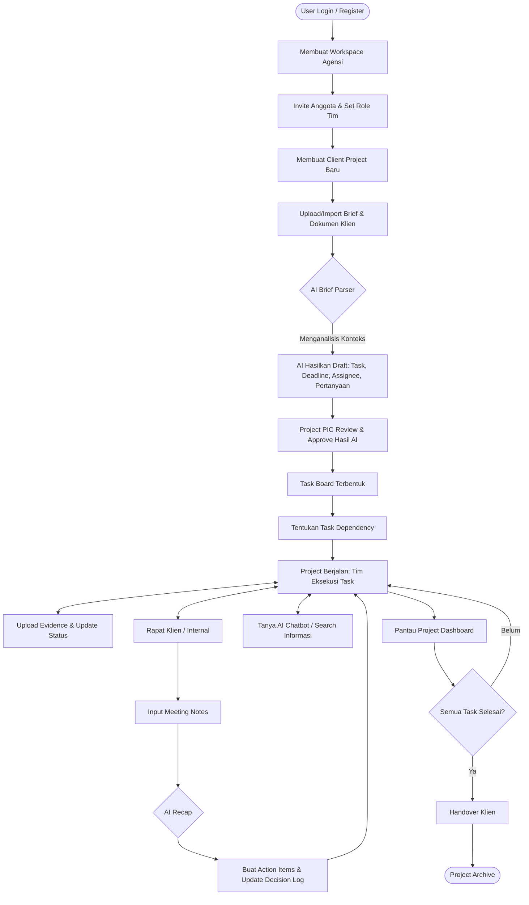

# Koladi: Analisis Perubahan & Workflow (Versi Terbaru)

## 1. Ringkasan Perubahan Arah Produk

Koladi sedang bertransisi dari platform **"All-in-One Digital Office"** yang general dan luas, menjadi **"AI Project Workspace untuk Tim Jasa Digital Project-Based"** yang terfokus. 

Fokus sebelumnya adalah mengelola seluruh aspek perusahaan (termasuk chat internal, pengumuman HR, absensi, dan hierarki korporat kompleks). Fokus terbaru adalah **produktivitas project klien** untuk agensi kecil dan freelancer. Peran AI tidak hanya sekadar pelengkap, melainkan menjadi inti *workflow* (AI Brief Parser, AI Meeting Recap, AI Chatbot) untuk mempercepat transisi dari *requirement* klien menjadi eksekusi (*tasks*). 

Desain baru ini membuang fitur-fitur administratif perusahaan yang kaku dan menggantinya dengan kolaborasi yang gesit, transparan (untuk klien), dan tersentralisasi pada *Project*.

---

## 2. Mapping Fitur Lama ke Fitur Baru

Berikut adalah hasil analisis dari struktur database/model lama dibandingkan dengan visi Koladi yang baru:

| Fitur / Model Lama di Codebase | Status | Bentuk di Koladi Versi Terbaru | Catatan Implementasi |
| :--- | :--- | :--- | :--- |
| `Workspace` | **Dipakai & Diperluas** | Level tertinggi agensi/tim | Menjadi wadah utama yang menaungi seluruh *Client Project*. |
| `Company` / `UserCompany` | **Direvisi / Dipangkas** | Digabung ke `Workspace` | Sistem multi-company yang rumit disederhanakan. Agensi = Workspace. |
| `Task`, `BoardColumn`, `Label` | **Dipakai & Ditambah** | Task Board, AI Task | Tetap menjadi *core*, namun butuh penambahan relasi untuk *Task Dependency* & *AI Owner Suggestion*. |
| `File`, `Folder`, `Attachment` | **Direvisi** | Brief & Dokumen, SOP | Dibatasi secara ketat per *Project*. Ditambah integrasi *Drive/Docs*. |
| `CalendarEvent`, `CalendarParticipant` | **Dipakai** | Calendar / Deadline View | Difokuskan murni untuk *deadline project* dan *meeting* klien. |
| `Conversation`, `Message` | **Dipangkas** | *Dihapus dari MVP* | Chat internal *real-time* tidak difokuskan, diganti dengan komentar pada Task & AI Chatbot. |
| `Pengumuman`, `AnnouncementRecipient` | **Dipangkas** | *Dihapus dari MVP* | Fitur HR/Korporat tidak lagi relevan untuk *use-case* project-based. |
| `Mindmap`, `MindmapNode` | **Dipangkas** | *Dihapus dari MVP* | Disembunyikan karena bukan kebutuhan esensial *project delivery*. |
| `WorkspacePerformanceSnapshot` | **Dipangkas** | *Dihapus dari MVP* | Laporan kinerja spesifik individu dihilangkan, fokus ke *Project Dashboard* (progress task). |
| `Role` | **Direvisi** | Owner, PIC, Member, Client | Penyederhanaan dari struktur SuperAdmin/Admin Sistem yang kaku. |
| *(Belum ada)* | **Ditambah Baru** | Client Project | Pemisahan ruang kerja spesifik per klien di bawah Workspace. |
| *(Belum ada)* | **Ditambah Baru** | Task Dependency | Relasi antar `Task` (blocker, depends on). |
| *(Belum ada)* | **Ditambah Baru** | Log System | *Decision Log*, *Evidence Log*, *Activity Log* spesifik project. |
| *(Belum ada)* | **Ditambah Baru** | AI Modules | *AI Brief Parser*, *Meeting Recap*, *Project Chatbot*. |

---

## 3. Struktur Hierarki Aplikasi Terbaru

Struktur aplikasi dirombak dari hirarki perusahaan menjadi hirarki project:

**`Workspace`** *(Agensi / Tim Freelancer)*
 └── **`Client Project`** *(Misal: Rebranding PT XYZ)*
      ├── **Modul AI & Perencanaan**
      │    ├── Brief & Dokumen (Upload / GDrive)
      │    └── AI Brief Parser (Ekstrak jadi Task)
      ├── **Modul Eksekusi**
      │    ├── Task Board (Kanban / List)
      │    └── Calendar / Deadline View
      ├── **Modul Dokumentasi & Log**
      │    ├── Meeting Recap
      │    ├── Decision Log & Evidence Log
      │    └── SOP Knowledge Base
      └── **Modul Navigasi & Insight**
           ├── Project Dashboard
           └── AI Project Chatbot / Search Global

---

## 4. Role dan Hak Akses Terbaru

Struktur hak akses disederhanakan menjadi 4 peran krusial dalam *project-based work*:

1. **Owner**: Pemilik *Workspace* (Agensi/Ketua Tim). Memiliki akses penuh ke *Billing*, pembuatan *Project*, mengundang anggota, dan menghapus *Workspace*.
2. **Project PIC**: Penanggung jawab utama *Client Project*. Bisa mengelola *Task Board*, menyetujui hasil *AI Brief Parser*, mengundang klien, dan memodifikasi *Decision Log*.
3. **Member**: Anggota tim eksekutor (Desainer, Developer, Copywriter). Bisa mengerjakan *Task*, memindahkan status Kanban, upload *Evidence*, dan menggunakan *AI Chatbot*.
4. **Client Viewer**: Akses terbatas untuk Klien. Hanya bisa melihat *Project Dashboard*, *Task Board* (mungkin dengan *view* terbatas), *Decision Log*, dan *Evidence Log*. Tidak bisa mengubah struktur task tanpa izin.

---

## 5. Modul Utama Koladi Versi Terbaru

1. **Brief & Dokumen**: Tempat sentral upload dokumen mentah klien (PDF, Word) atau *link* Google Docs/Notion.
2. **AI Brief Parser**: Otak utama perencanaan. AI membaca dokumen *Brief*, lalu otomatis menghasilkan draf *deliverable*, memecahnya menjadi *Task*, menebak *deadline*, menyarankan *assignee* (berdasarkan *load/role*), dan membuat daftar pertanyaan klarifikasi untuk klien.
3. **Task Board**: Papan kerja utama (Kanban/List) tempat *Task* dieksekusi.
4. **Task Dependency**: Fitur penanda *bottleneck* (Task B tidak bisa dimulai jika Task A belum selesai).
5. **Meeting Recap to Task**: Upload notula/transkrip rapat, AI menyimpulkan *action items* dan langsung mengubahnya menjadi draf *Task*.
6. **Decision Log**: Catatan resmi keputusan penting (misal: "Klien memilih opsi desain A", disetujui tanggal X). Penting untuk *cover-your-ass* agensi.
7. **Evidence Log**: Kumpulan bukti pekerjaan selesai (URL *staging*, *link* desain Figma final, *screenshot*).
8. **Activity Log**: *Audit trail* otomatis dari semua perubahan di *Project* (siapa memindahkan task apa, siapa upload apa).
9. **SOP Knowledge Base**: Repositori prosedur standar internal tim spesifik project atau general agensi (contoh: "Cara setup server", "Guideline Logo Klien A").
10. **AI Project Chatbot**: Asisten yang memiliki konteks seluruh project. User bisa bertanya: *"Kapan deadline revisi desain?"* atau *"Apa keputusan kita minggu lalu soal warna UI?"*
11. **Search**: Pencarian instan (Global/Project-level) untuk mencari task, file, log, dan meeting notes.
12. **Project Dashboard**: Ringkasan persentase penyelesaian, *blocking tasks*, dan kesehatan project.
13. **Calendar / Deadline View**: Visualisasi waktu dari semua *Task* ber-deadline.
14. **Project Archive**: Membekukan project yang sudah *handover* agar read-only dan tidak memenuhi *Workspace* aktif.
15. **Billing**: Sistem paket berlangganan untuk *Workspace* (Limit user, limit project, limit quota AI).
16. **Notifikasi**: Pemberitahuan sederhana (Email/In-App) saat di-*assign* task atau di-*mention*.

---

## 6. Flowchart Workflow

Berikut adalah alur penggunaan ideal (Golden Path) dari awal hingga akhir project:

---

## 7. Rekomendasi Perubahan Teknis dari Codebase Lama

**A. Perubahan Database & Model:**
1. **Tambah Model `ClientProject`**: Memiliki relasi ke `Workspace`.
2. **Ubah `Task`**: Tambahkan kolom `client_project_id` dan tabel `task_dependencies` (task_id, depends_on_task_id).
3. **Tambah Model Logs**: `DecisionLog`, `EvidenceLog`, `ActivityLog` (bisa polimorfik atau spesifik project).
4. **Simplifikasi `Role`**: Buang *seeder* role lama, ganti dengan 4 role baru (Owner, PIC, Member, Client Viewer).
5. **Update `File` / `Folder`**: Pastikan semuanya diikat (relasi) ke `ClientProject`.

**B. Controller & Service yang Perlu Dibuat:**
1. **`AIBriefParserService`**: Integrasi LLM (OpenAI/Anthropic) yang menerima input teks dokumen dan mem-parsing output JSON menjadi struktur `Task`.
2. **`AIMeetingRecapService`**: LLM pembuat kesimpulan dari teks rapat.
3. **`ProjectDashboardController`**: Agregasi data (count task per status, overdue tasks) per project.
4. **`SearchController`**: Memanfaatkan Laravel Scout.

**C. Perubahan UI/UX:**
1. **Navigasi Kiri**: Fokus menampilkan *List of Active Client Projects*.
2. **Workspace Switcher**: Dropdown sederhana di atas.
3. **Hide / Disable Fitur Lama**: Hapus menu "Chat", "Mindmap", "Pengumuman", dan "Perusahaan/HR" dari sidebar.

**D. Integrasi Eksternal (MVP):**
1. **LLM API** (OpenAI GPT-4o / Claude 3.5 Sonnet) untuk *Brief Parser*, *Recap*, dan *Chatbot*.
2. **Google Drive / Google Docs** (OAuth untuk read/import link dokumen).
3. **Laravel Scout** (Algolia/Meilisearch/Database driver) untuk *Search*.

---

## 8. Prioritas Implementasi MVP

Membangun semuanya sekaligus berisiko lambat rilis. Berikut urutan prioritas:

**P0: Fundamental & "Aha Moment" (Wajib untuk Demo MVP)**
- Autentikasi, Struktur Workspace & Client Project.
- Task Board (Kanban sederhana) & Role (Owner, PIC, Member).
- **AI Brief Parser** (fitur kunci pembeda dari kompetitor).
- Brief & Dokumen Upload.

**P1: Melengkapi Workflow Project (Penting Setelah MVP Dasar Jalan)**
- Task Dependency.
- Meeting Recap to Task (AI).
- Project Dashboard & Activity Log.
- Decision Log & Evidence Log.
- Role *Client Viewer*.

**P2: Fase Lanjut (Nice to Have)**
- AI Project Chatbot (membutuhkan infrastruktur RAG / Vector DB).
- Integrasi Native (Notion, Google Calendar).
- SOP Knowledge Base.
- Billing / Paket Berlangganan.
- Pencarian Global Canggih.

---

## 9. Daftar Halaman Baru (UI/Views) yang Dibutuhkan

Berdasarkan fitur-fitur baru di atas, ada beberapa **halaman UI baru** yang harus dibuat dari nol (atau merombak total UI lama):

1. **Project Selection / Workspace Landing Page**
   Halaman pertama setelah login. Menampilkan daftar *Client Project* berbentuk *cards* dengan ringkasan status kesehatan project (On Track, At Risk, Delayed).

2. **AI Brief Parser & Review Page**
   Halaman khusus untuk mengunggah dokumen *brief*. Setelah di-upload, halaman ini berubah menjadi *Review Interface* di mana user bisa melihat teks *brief* berdampingan (split-screen) dengan hasil ektraksi AI (draft Task, assignee, deadline) sebelum di-klik "Approve to Board".

3. **Project Dashboard (Per Klien)**
   Halaman *Overview* saat user masuk ke satu project tertentu. Isinya grafik progress task, aktivitas terbaru, daftar *blocker* (task mandek), dan *quick links* ke SOP klien.

4. **Meeting Recap & Action Items Page**
   Antarmuka untuk mengunggah *voice note* atau teks transkrip rapat. Halaman ini akan menampilkan kesimpulan rapat (yang di-generate AI) dan tombol "Convert to Tasks" untuk *action items*.

5. **Logs Hub (Decision, Evidence, Activity)**
   Sebuah halaman (atau sekumpulan tab) spesifik project berupa tabel/timeline panjang yang berisi:
   - **Decision Log**: Tabel catatan keputusan (Siapa yang setuju, tanggal, deskripsi).
   - **Evidence Log**: Galeri/List tautan hasil kerja final.
   - **Activity Log**: *Timeline* aktivitas (mirip jejak audit log).

6. **Task Dependency / Timeline View**
   Selain bentuk Kanban, butuh tampilan baru (misalnya *Gantt Chart* sederhana atau relasi antar Task) untuk memvisualisasikan *bottleneck* (Task A memblokir Task B).

7. **AI Project Chatbot Interface**
   Panel obrolan (bisa berbentuk *floating window* di pojok kanan bawah atau satu halaman penuh) tempat user bisa berinteraksi dengan AI yang memahami konteks seluruh file & task di dalam project tersebut.

8. **Client Viewer Portal (Read-Only)**
   Tampilan *dashboard* yang disederhanakan khusus ketika yang login adalah klien (klien tidak melihat dapur internal yang berantakan, melainkan progress rapi, *Decision Log*, dan tombol *Approve*).
